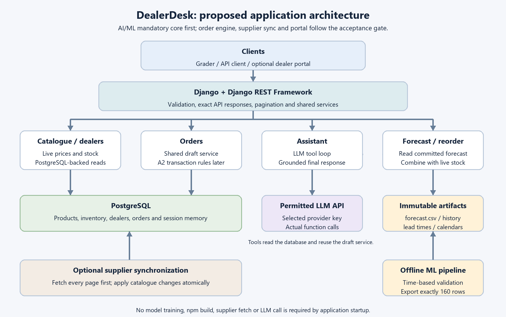
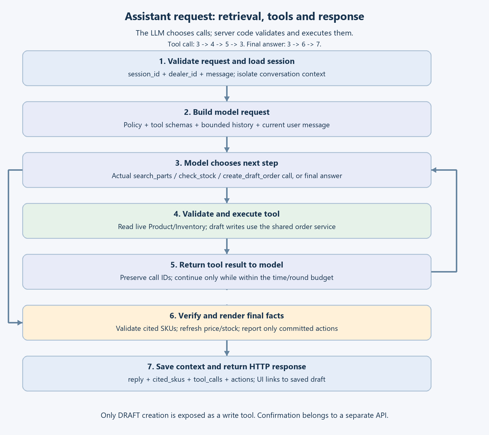
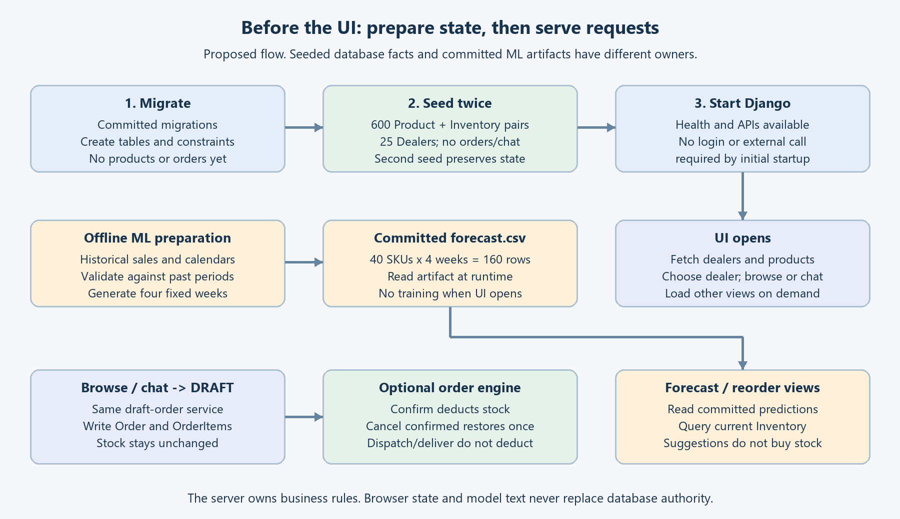
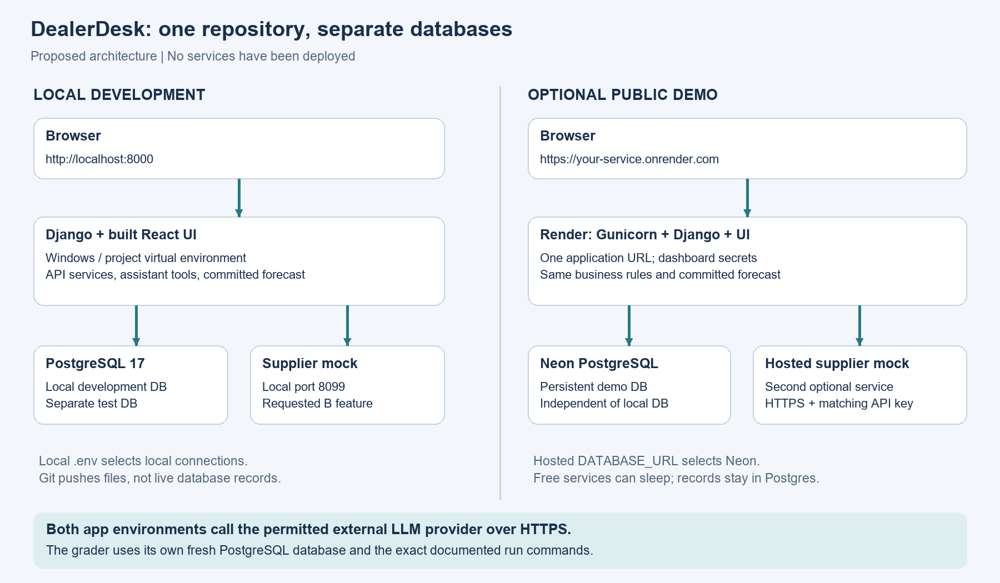

# VIKMO DealerDesk

**Track:** AI/ML


DealerDesk is a dealer ordering platform for a motorcycle and car parts distributor. It combines a searchable parts catalogue and live inventory with an LLM-powered assistant, demand forecasting, reorder suggestions, order management, and supplier catalogue synchronization.

Built with Django 5.2, Django REST Framework, PostgreSQL, and React.

## Table of contents

- [Features and scope](#features-and-scope)
- [Architecture](#architecture)
- [Assistant request flow](#assistant-request-flow)
- [Startup and runtime flow](#startup-and-runtime-flow)
- [Quick start](#quick-start)
- [Configuration](#configuration)
- [Dealer assistant](#dealer-assistant)
- [Forecasting and reorder suggestions](#forecasting-and-reorder-suggestions)
- [Supplier synchronization](#supplier-synchronization)
- [Frontend](#frontend)
- [Tests and verification](#tests-and-verification)
- [Project structure](#project-structure)
- [Design decisions](#design-decisions)
- [Assumptions and limitations](#assumptions-and-limitations)
- [Optional hosting topology](#optional-hosting-topology)
- [Video walkthrough](#video-walkthrough)

## Features and scope

| Component | What it covers | Status |
|---|---|---|
| Backend core | Products, inventory, dealers, and draft orders | Implemented |
| Dealer assistant | LLM tool calling, product retrieval, live stock checks, and draft-order creation | Implemented |
| Forecasting and reorder | Four-week forecast artifact and live reorder suggestions | Implemented |
| Order engine | Confirm, dispatch, deliver, cancel, stock safety, and idempotency | Implemented |
| Supplier synchronization | Paginated, rate-limited, fault-tolerant catalogue import | Implemented |
| Dealer portal | React web interface served by Django | Implemented |

## Architecture

The application uses Django and Django REST Framework as the API and business-logic layer. PostgreSQL stores catalogue, inventory, dealer, order, and session data. The assistant calls a permitted LLM provider and uses application-owned tools. Forecast predictions are generated offline and read by the application at runtime.



*Figure 1. Application architecture showing Django + DRF validation layer, PostgreSQL database, permitted LLM API, and immutable ML artifacts. AI/ML mandatory core first; order engine, supplier sync and portal follow the acceptance gate.*

### Main design principles

- **The server owns business rules.** The model and browser do not replace database authority.
- **Live data stays authoritative.** Price and stock are read from PostgreSQL when needed.
- **Draft creation is separate from confirmation.** Creating a draft does not reserve stock.
- **Forecasting runs offline.** The application reads the committed forecast artifact rather than training a model during startup or a user request.
- **Optional integrations are isolated.** Missing supplier configuration should affect supplier sync, not basic application startup.

## Assistant request flow

The assistant uses a tool-calling loop. The LLM chooses whether to request a supported tool, while server-side code validates and executes the call. Tool results are returned to the model, and the final response is checked and rendered using current application data.



*Figure 2. Assistant request: retrieval, tools and response. The LLM chooses calls; server code validates and executes them. Tool call: 3 -> 4 -> 5 -> 3. Final answer: 3 -> 6 -> 7. Only DRAFT creation is exposed as a write tool. Confirmation belongs to a separate API.*

The assistant exposes three application-owned tools:

- `search_parts`
- `check_stock`
- `create_draft_order`

The assistant can create draft orders only. Order confirmation is handled by a separate API and business workflow.

## Startup and runtime flow

Database migrations and seeding prepare application state. Forecast generation and validation are offline tasks. At runtime, the application reads the committed forecast artifact and queries current inventory for reorder suggestions.



*Figure 3. Before the UI: prepare state, then serve requests. Seeded database facts and committed ML artifacts have different owners. The server owns business rules. Browser state and model text never replace database authority.*

## Quick start

### Requirements

- Python 3.11+
- PostgreSQL
- Git
- Node.js 22.12+ only if you need to modify or rebuild the frontend

Docker, Redis, a vector database, and a cloud account are not required for local evaluation.

### Linux / macOS

Create an empty PostgreSQL database first, for example `createdb dealerdesk`, and set `DATABASE_URL` in `.env` to point to it.

```bash
python3 -m venv .venv
source .venv/bin/activate
# Fish shell: source .venv/bin/activate.fish

pip install -r requirements.txt
cp .env.example .env
# Set DATABASE_URL and, for live assistant calls, GROQ_API_KEY.

python manage.py migrate --noinput
python manage.py seed_data
python manage.py seed_data  # Safe to run repeatedly.
python manage.py runserver 0.0.0.0:8000 --noreload
```

Open `http://localhost:8000`, choose a dealer in the header, browse for a part, add it to the basket, and create a draft order.

A fresh seed loads 600 products, 600 inventory records, and 25 dealers. Running the seed again preserves existing stock and prices.

### Windows

The helper starts an isolated local PostgreSQL cluster on port `55432`; its data and generated credentials stay in the ignored `.local/` directory.

```powershell
python -m venv .venv
.\.venv\Scripts\python.exe -m pip install -r requirements.txt
.\.venv\Scripts\python.exe scripts/local_postgres.py start
.\.venv\Scripts\python.exe manage.py migrate --noinput
.\.venv\Scripts\python.exe manage.py seed_data
.\.venv\Scripts\python.exe manage.py runserver 0.0.0.0:8000 --noreload
```

Use `scripts/local_postgres.py status` or `scripts/local_postgres.py stop` to manage the local database cluster.

## Configuration

Configuration is read from environment variables or a root `.env` file. Real environment variables take precedence.

| Variable | Purpose |
|---|---|
| `DATABASE_URL` | Required PostgreSQL connection URL. SQLite is not supported. |
| `GROQ_API_KEY` | API key for the configured assistant provider. |
| `LLM_PROVIDER` | Optional provider selection; `groq` is used for this setup. |
| `LLM_MODEL` | Optional model override. |
| `SUPPLIER_API_URL` | Supplier API base URL; the local mock uses `http://127.0.0.1:8099`. |
| `SUPPLIER_API_KEY` | Supplier API key; the local mock uses `dev-supplier-key`. |
| `DJANGO_DEBUG` | Defaults to `1` for local development; use `0` when hosting. |
| `DJANGO_SECRET_KEY` | Private Django secret, required when hosting. |
| `DJANGO_ALLOWED_HOSTS` | Comma-separated hostnames when hosting. |

Alternative provider transports have configuration support, but live behaviour has only been verified with Groq. Never commit `.env` files or real API keys.

## Dealer assistant

- **Provider:** Groq
- **Model:** `openai/gpt-oss-120b`, called through Groq's tool-calling API
- **Tools:** `search_parts`, `check_stock`, and `create_draft_order`
- **Retrieval:** Weighted lexical search over live product metadata, including SKU and vehicle matching, synonyms, and BM25-style scoring. It does not use embeddings.
- **Grounding:** Price and stock figures are rendered from PostgreSQL immediately before the response is returned, rather than being trusted from model-generated text or earlier turns.
- **Safe order actions:** The assistant can create drafts through the shared order service. It cannot confirm orders, and a draft does not reserve stock.
- **Untrusted catalogue text:** Supplier descriptions are excluded from the model's context.
- **Session memory:** Conversation state is stored in PostgreSQL by `session_id`; sessions do not share memory.

To check the live provider after configuring `GROQ_API_KEY`:

```bash
python manage.py check_assistant
python manage.py check_assistant --create-draft
```

The second command creates a real draft order. Run it only against a development/demo database. These checks exercise specific scenarios and do not guarantee that every future request or provider condition will succeed.

## Forecasting and reorder suggestions

`ml/forecast.csv` contains 160 rows: four weekly forecasts for each of 40 products. It is generated by a reproducible offline training script; the application does not train the model when a page opens or an API request arrives.

The documented pipeline accounts for known promotions, the Diwali-linked festive lift, sparse products, and new products. It uses chronological validation to avoid training on future observations.

On the historical holdout, the reported metrics were:

| Metric | Forecast model |
|---|---:|
| MAE | 6.34 |
| RMSE | 10.45 |
| WAPE | 18.61% |
| Best simple-average baseline WAPE | 25.71% |

These are historical validation results, not a guarantee of accuracy on future unseen weeks.

`GET /api/reorder-suggestions/` reads live inventory on each request and applies the configured safety-stock formula to the committed forecast.

```bash
python -m ml.validate_forecast
python -m ml.train_forecast
```

Run validation before regenerating or submitting a forecast artifact.

## Supplier synchronization

`POST /api/sync/supplier/` imports the supplier catalogue. The sync fetches every page before applying catalogue changes in a transaction. It retries rate limits and temporary failures. If the full feed cannot be fetched, no catalogue changes are applied and the endpoint returns `502 SUPPLIER_UNAVAILABLE`.

Invalid rows are skipped and reported, the latest valid duplicate wins, and supplier stock is not copied into available inventory.

The supplied mock can be used to exercise pagination and failure handling:

```bash
python supplier_mock/mock_supplier.py
python supplier_mock/mock_supplier.py --outage
```

## Frontend

The React portal source is in `frontend/`, and Django serves the built assets through `portal/`. Node.js is only required when modifying or rebuilding the frontend.

```bash
cd frontend
npm ci
npm run dev
npm run lint
npm run format:check
npm run build
```

The Vite development server proxies `/api` requests to Django on port `8000`. After rebuilding, restart `runserver --noreload` so the page uses the updated asset names, and commit the source and compiled output.

Browser tests require Playwright's browser installation. See the frontend scripts and test configuration for the exact setup.

## Tests and verification

Install development dependencies and run the checks:

```bash
pip install -r requirements-dev.txt
python manage.py test --noinput
python manage.py makemigrations --check --dry-run
ruff check .
ruff format --check .
```

The database role needs `CREATEDB` because Django creates a separate test database.

Recorded local results in the supplied project documentation: 47 backend tests and five automated browser tests passed. Clean-database smoke checks reported 10/10 for the AI/ML track, 9/9 for Django, and 12/12 across all parts. These local checks do not replace the evaluator's hidden tests.

To run the smoke checks against a freshly seeded local instance:

```bash
python smoke_test.py --base-url http://localhost:8000 --track aiml
python smoke_test.py --base-url http://localhost:8000 --all
```

The full verification helper creates and removes a uniquely named temporary PostgreSQL database:

```bash
python scripts/verify_submission.py --track all
```

The `--all` option requires the supplier mock and an LLM key to be configured.

## Project structure

```text
dealerdesk/
├── dealerdesk/       Django settings, root routes, WSGI
├── catalogue/        Product and inventory models, APIs, migrations
├── dealers/          Dealer model, APIs, migrations
├── orders/           Order services, money snapshots, concurrency tests
├── assistant/        LLM provider, retrieval, prompts, tools, session memory
├── forecasting/      Forecast artifacts and live reorder API
├── suppliers/        Supplier fetch/retry and atomic catalogue updates
├── core/              Shared errors, pagination, seeding, live-check commands
├── portal/            Django page and compiled React assets
├── frontend/          React source, Vite configuration, browser tests
├── ml/                Training, validation, and forecast artifact
├── data/              Supplied CSV data
├── supplier_mock/     Local supplier API mock
├── scripts/           Local PostgreSQL helper and submission verification
└── manage.py          Django entry point
```

## Design decisions

- **Business rules live in services.** Order, stock, and supplier changes go through backend service functions. Database locking and constraints protect stock updates and order-number uniqueness.
- **Money uses decimal arithmetic.** Monetary values use `Decimal`, with GST calculated per line and rounded half-up to the paisa.
- **Network calls stay outside dependent transactions.** Supplier HTTP calls and LLM requests complete before the database transaction that depends on their result.
- **Consistent errors.** API failures use a consistent JSON error shape and stable error codes.
- **Forecast artifacts are explicit.** Training and validation are reproducible offline steps; runtime APIs read the committed output.

## Assumptions and limitations

- Authentication is not implemented, matching the assignment's stated scope; use synthetic demo data only.
- Lexical retrieval can miss unusual wording and does not use embeddings.
- Supplier stock is not added to available inventory; supplier sync updates catalogue fields only.
- Draft orders do not reserve stock. Confirmation is a separate operation.
- Live provider behaviour has been verified with Groq; alternative provider transports have not been verified with live keys.
- Forecast metrics reflect historical validation and may not represent future performance.
- Hosting is optional and not required for evaluation.

## Optional hosting topology

Hosting is optional. The intended deployment is one Django application serving the built React assets, connected to a hosted PostgreSQL database. The local and hosted environments use separate databases; pushing Git files does not push database records.



*Figure 4. DealerDesk: one repository, separate databases. Proposed architecture | No services have been deployed. Local .env selects local connections. Git pushes files, not live database records. Both app environments call the permitted external LLM provider over HTTPS. The grader uses its own fresh PostgreSQL database and the exact documented run commands.*

For a hosted environment, set `DJANGO_DEBUG=0`, configure a private `DJANGO_SECRET_KEY` and `DJANGO_ALLOWED_HOSTS`, and use the hosted database URL. Keep all secrets in the hosting provider's environment configuration.

## Video walkthrough

**Video:** [Watch Demo](https://drive.google.com/file/d/1UX60PXKKC8YYtb5LOKZetflzV_XA2K-e/view?usp=sharing)

The video demonstrates the assistant's tool-calling loop from the user's message to the final reply, walking through the code implementation in detail.
